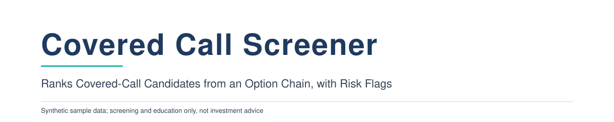
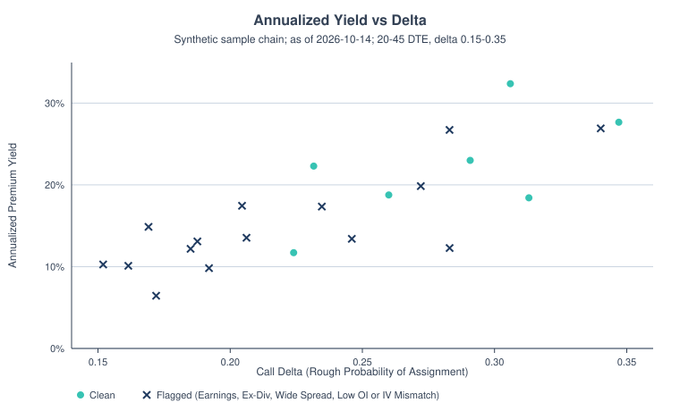
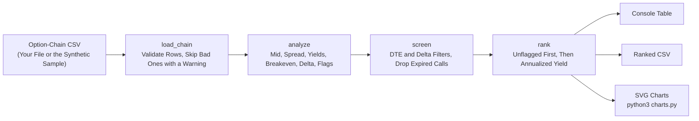
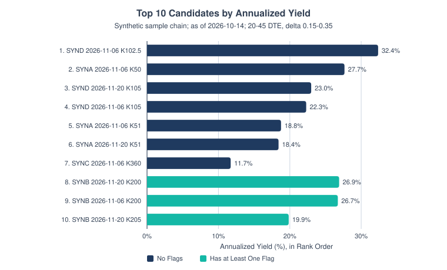
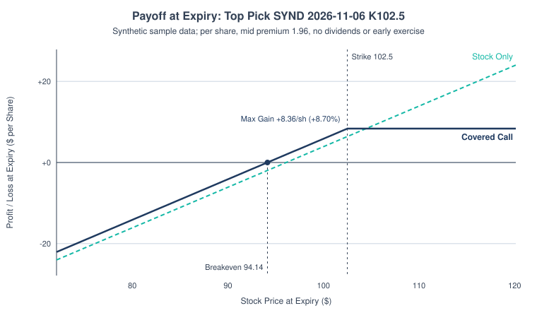
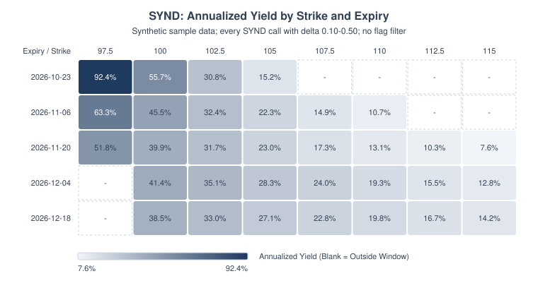
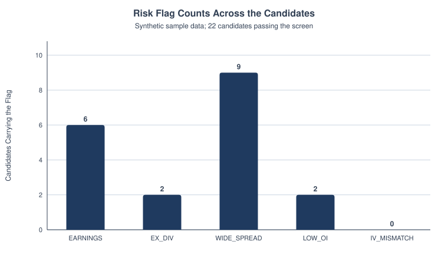
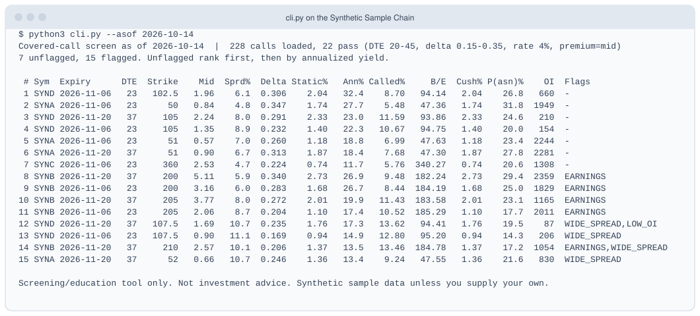

<p align="center">
  <picture>
    <source media="(prefers-color-scheme: dark)" srcset="docs/banner-dark.svg">
    
  </picture>
</p>

  

A small, dependency-free Python tool that reads an option-chain CSV and ranks
covered-call candidates: premium yield, breakeven, if-called return, a
Black-Scholes delta (as a rough assignment-probability proxy), and flags for
the things that quietly wreck a covered call (earnings or an ex-dividend date
before expiry, wide spreads, thin open interest, and price/vol mismatches).

> **Synthetic data.** The bundled chain uses fictional tickers (SYNA to SYND)
> and simulated prices. It illustrates the mechanics and says nothing about any
> real security. Screening and education only, not investment advice.

**Why it matters.** A covered call swaps upside above the strike for cash today, and the yield on the
screen is only worth it if the downside cushion, the cap and the event risk are worth it too.

Payoff at expiry per share for the top pick on the synthetic sample (SYND 2026-11-06, strike 102.5,
spot 96.10, premium 1.96), from `ccscreen.charts.payoff_points`:

| Price at Expiry | Stock Only | Covered Call |
|---|---|---|
| 85.00 | -11.10 | -9.14 |
| 90.00 | -6.10 | -4.14 |
| 94.14 (breakeven) | -1.96 | +0.00 |
| 96.10 (spot) | +0.00 | +1.96 |
| 100.00 | +3.90 | +5.86 |
| 102.50 (strike) | +6.40 | +8.36 |
| 110.00 | +13.90 | +8.36 (capped) |

## Contents

- [Chart](#chart)
- [Results at a Glance](#results-at-a-glance)
- [How It Works](#how-it-works)
- [Quickstart](#quickstart)
- [Charts](#charts)
- [Sample Output](#sample-output)
- [Presets, Earnings Exclusion and Roll Check](#presets-earnings-exclusion-and-roll-check)
- [Methodology](#methodology)
- [Optional: Matplotlib Plots](#optional-matplotlib-plots)
- [Skills Shown](#skills-shown)
- [Limitations](#limitations)
- [Project Layout](#project-layout)
- [Data Sources](#data-sources)
- [License](#license)
- [Glossary](#glossary)

## Chart

<picture>
  <source media="(prefers-color-scheme: dark)" srcset="docs/yield_vs_delta-dark.svg">
  
</picture>

*Annualized yield vs. delta for the 22 calls that pass the filters on the synthetic sample. Navy X marks carry at least one flag. Yield rises with delta because you are selling closer to the money.*

## Results at a Glance

Synthetic sample, as of 2026-10-14, default filters (DTE 20 to 45, delta 0.15 to 0.35):

| Measure | Value |
|---|---|
| Calls Loaded | 228 |
| Calls Passing the Filters | 22 |
| Unflagged / Flagged | 7 / 15 |
| Top-Ranked Call | SYND 2026-11-06, strike 102.5, 32.4% annualized, delta 0.306 |
| Top Pick Breakeven / If-Called Return | 94.14 / +8.70% |

- Row 8 (SYNB) has a 26.9% annualized yield but ranks below rows 5 to 7 because of the EARNINGS flag. Flagged calls always sit below unflagged ones.

## How It Works



- Loads a chain CSV (bad rows are skipped with a warning, not silently).
- Computes per call: mid, bid/ask spread %, DTE, static and annualized yield,
  if-called return, downside breakeven, delta.
- Uses the vendor `delta` column if present; otherwise computes Black-Scholes
  delta from `iv`, a risk-free rate, and an optional dividend yield.
- Flags `EARNINGS`, `EX_DIV`, `EARLY_ASSIGN` (a rule-of-thumb early-assignment warning; see Flags below),
  `WIDE_SPREAD`, `LOW_OI`, `LOW_VOLUME` and `THIN_PREMIUM` (both off unless you set a threshold),
  and `IV_MISMATCH` (a quote whose price and implied vol disagree, which points to a stale or inconsistent row).
- Adds `prob_assigned` to the CSV and the table (`P(asn)%`): the risk-neutral chance the call finishes in the money,
  N(d2) at the row's `iv`. With no dividend yield it sits below delta (N(d1)); with a dividend yield it can sit above
  the delta column, so do not read it as a strict upper bound on delta. It is model-based (lognormal, constant vol),
  not a forecast.
- Prints `Cush%` in the table: the downside cushion, premium divided by spot, as a percent (`downside_cushion` in the CSV).
- Skips rows with `nan`/`inf` numbers (with a warning) and calls that expire on or before the as-of date instead of failing on them.
- Filters by DTE and delta, ranks, prints a table, writes a CSV and an SVG.
- Makes no network calls: you supply the chain CSV.

## Quickstart

Requires Python 3.9+. No `pip install` needed for the core.

```bash
python3 cli.py --asof 2026-10-14                       # bundled synthetic chain, default filters
python3 cli.py --asof 2026-10-14 --min-delta 0.10 --max-delta 0.30 --min-dte 30 --max-dte 60
python3 cli.py my_chain.csv --rate 4.25 --min-oi 250 --max-spread 8 --exclude-flagged
python3 cli.py my_chain.csv --preset weekly --exclude-earnings    # weekly expiries, no earnings in window
python3 cli.py my_chain.csv --min-volume 50 --min-premium 0.25   # optional liquidity cutoffs (off by default)
python3 cli.py --asof 2026-10-14 --csv output/screen.csv --svg output/yield_vs_delta.svg
python3 -m unittest discover -v                        # run the tests
python3 charts.py                                      # regenerate every SVG in docs/ (light and dark)
python3 plots_mpl.py                                   # optional: matplotlib PNGs in docs/mpl/
python3 data/generate_sample.py                        # regenerate the synthetic chain
```

Use `python3 cli.py -h` for all options. `--asof` defaults to today; the
sample chain is dated for 2026-10-14, so pass that date to reproduce the
output below.

**Input columns:** `underlying, spot, expiry, strike, bid, ask, iv,
open_interest, volume` (required) and `delta, ex_dividend_date,
earnings_date, dividend` (optional). `dividend` is the next cash dividend per share;
it feeds the `EARLY_ASSIGN` check, and negative values are skipped with a warning. Dates are `YYYY-MM-DD`; `iv` is a decimal
(0.32 = 32%). A row with `iv` above 5 is skipped with a warning, because it is almost certainly a percent typed
as a number (32 instead of 0.32); the screener never rescales it. A vendor `delta` outside 0 to 1 is also skipped with a warning. Lines starting with `#` are treated as comments.

## Charts

There are five charts, and the scatter above is the hero. All use the synthetic sample.
Each has a light and a dark SVG, and `python3 charts.py` regenerates all of them.

<picture>
  <source media="(prefers-color-scheme: dark)" srcset="docs/top_candidates-dark.svg">
  
</picture>

*Top 10 candidates in rank order. The screen has no separate score: the bars show annualized yield, and unflagged calls rank first, so the flagged teal bars start at rank 8.*

<picture>
  <source media="(prefers-color-scheme: dark)" srcset="docs/payoff_top_pick-dark.svg">
  
</picture>

*Payoff at expiry for the top pick (SYND 2026-11-06, strike 102.5, mid premium 1.96). Below breakeven (94.14), the covered call still loses money, but the premium cushions the stock's drop by 1.96 per share. Above the strike the gain is capped at +8.36 per share.*

<picture>
  <source media="(prefers-color-scheme: dark)" srcset="docs/strike_expiry_heatmap-dark.svg">
  
</picture>

*Annualized yield by strike (columns) and expiry (rows) for SYND (synthetic data). Yield falls as the strike moves above spot. Blank cells fall outside the delta window.*

<picture>
  <source media="(prefers-color-scheme: dark)" srcset="docs/risk_flags-dark.svg">
  
</picture>

*How many of the 22 candidates carry each flag. WIDE_SPREAD is the most common; no candidate trips the IV_MISMATCH check.*

## Sample Output

<picture>
  <source media="(prefers-color-scheme: dark)" srcset="docs/sample-output-dark.svg">
  
</picture>

<details>
<summary>Full Output</summary>

```
Covered-call screen as of 2026-10-14  |  228 calls loaded, 22 pass (DTE 20-45, delta 0.15-0.35, rate 4%, premium=mid)
7 unflagged, 15 flagged. Unflagged rank first, then by annualized yield.

 # Sym  Expiry      DTE  Strike    Mid  Sprd%  Delta Static%   Ann% Called%     B/E  Cush% P(asn)%    OI  Flags
 1 SYND 2026-11-06   23   102.5   1.96    6.1  0.306    2.04   32.4    8.70   94.14   2.04    26.8   660  -
 2 SYNA 2026-11-06   23      50   0.84    4.8  0.347    1.74   27.7    5.48   47.36   1.74    31.8  1949  -
 3 SYND 2026-11-20   37     105   2.24    8.0  0.291    2.33   23.0   11.59   93.86   2.33    24.6   210  -
 4 SYND 2026-11-06   23     105   1.35    8.9  0.232    1.40   22.3   10.67   94.75   1.40    20.0   154  -
 5 SYNA 2026-11-06   23      51   0.57    7.0  0.260    1.18   18.8    6.99   47.63   1.18    23.4  2244  -
 6 SYNA 2026-11-20   37      51   0.90    6.7  0.313    1.87   18.4    7.68   47.30   1.87    27.8  2281  -
 7 SYNC 2026-11-06   23     360   2.53    4.7  0.224    0.74   11.7    5.76  340.27   0.74    20.6  1308  -
 8 SYNB 2026-11-20   37     200   5.11    5.9  0.340    2.73   26.9    9.48  182.24   2.73    29.4  2359  EARNINGS
 9 SYNB 2026-11-06   23     200   3.16    6.0  0.283    1.68   26.7    8.44  184.19   1.68    25.0  1829  EARNINGS
10 SYNB 2026-11-20   37     205   3.77    8.0  0.272    2.01   19.9   11.43  183.58   2.01    23.1  1165  EARNINGS
11 SYNB 2026-11-06   23     205   2.06    8.7  0.204    1.10   17.4   10.52  185.29   1.10    17.7  2011  EARNINGS
12 SYND 2026-11-20   37   107.5   1.69   10.7  0.235    1.76   17.3   13.62   94.41   1.76    19.5    87  WIDE_SPREAD,LOW_OI
13 SYND 2026-11-06   23   107.5   0.90   11.1  0.169    0.94   14.9   12.80   95.20   0.94    14.3   206  WIDE_SPREAD
14 SYNB 2026-11-20   37     210   2.57   10.1  0.206    1.37   13.5   13.46  184.78   1.37    17.2  1054  EARNINGS,WIDE_SPREAD
15 SYNA 2026-11-20   37      52   0.66   10.7  0.246    1.36   13.4    9.24   47.55   1.36    21.6   830  WIDE_SPREAD

Screening/education tool only. Not investment advice. Synthetic sample data unless you supply your own.
```

</details>

## Presets, Earnings Exclusion and Roll Check

**Weekly preset.** `--preset weekly` swaps the default window for weekly expiries: DTE 3 to 10 and the same delta
band (0.15 to 0.35). The window is a starting point, not a rule; edit `PRESETS` in `ccscreen/screen.py` or override
any value on the command line (`--preset weekly --max-dte 14`). With no preset the defaults (DTE 20 to 45,
delta 0.15 to 0.35) are unchanged.

**Earnings exclusion.** `--exclude-earnings` drops any call whose window contains an earnings date (the same
test as the `EARNINGS` flag, as-of date through expiry). It is off by default, so flagged calls normally stay
in the table. A call with no `earnings_date` in the file cannot be checked, so it is kept.

```bash
python3 cli.py --asof 2026-10-14 --preset weekly --exclude-earnings --top 3
```

```
Covered-call screen as of 2026-10-14  |  228 calls loaded, 5 pass (DTE 3-10, delta 0.15-0.35, rate 4%, premium=mid)
5 unflagged, 0 flagged. Unflagged rank first, then by annualized yield.

 # Sym  Expiry      DTE  Strike    Mid  Sprd%  Delta Static%   Ann% Called%     B/E  Cush% P(asn)%    OI  Flags
 1 SYND 2026-10-23    9     100   1.32    4.5  0.308    1.37   55.7    5.43   94.78   1.37    28.3   408  -
 2 SYNB 2026-10-23    9     195   1.75    4.6  0.266    0.93   37.9    5.02  185.60   0.93    24.6  4309  -
 3 SYND 2026-10-23    9   102.5   0.73    8.2  0.198    0.76   30.8    7.42   95.37   0.76    17.8   405  -

Screening/education tool only. Not investment advice. Synthetic sample data unless you supply your own.
```

**Roll check.** `python3 cli.py roll` is a read-only look at one open short call. Give it the chain CSV, the
as-of date, and the position (`--underlying`, `--strike`, `--expiry`, `--premium` received per share,
`--contracts`). It reports the buyback cost (the ask), intrinsic vs extrinsic value, assignment risk signals
(in the money, DTE, earnings before expiry, and an ex-dividend date before expiry with extrinsic below the
dividend), and roll candidates: later expiry, same or higher strike. Net roll credit is the new bid minus the
buyback ask, a conservative fill. Candidates rank by net credit per extra day of duration; if-called return is
(premium received + net roll credit + new strike - spot) / spot. A candidate with no usable quote, or any
candidate when the open call is missing from the chain, is UNKNOWN and not ranked.

```bash
python3 cli.py roll data/sample_chain.csv --asof 2026-10-14 --underlying SYND --strike 100 --expiry 2026-10-23 --premium 1.20 --contracts 2 --top 3
```

```
Roll check as of 2026-10-14: SYND 2x short 100 call expiring 2026-10-23, premium received 1.20/share
Research estimate, not advice.

Spot 96.10  |  Buyback (ask) 1.35  |  Intrinsic 0.00  |  Extrinsic 1.35
Buyback total 270.00; P/L if closed now -30.00
Assignment risk signals:
  - Not ITM
  - DTE 9

Roll candidates (later expiry, strike >= 100), ranked by net credit per extra day; net = new bid - buyback ask:
 # Expiry      DTE  Strike  NewBid  Net/sh Net total  Called%
 1 2026-12-04   51     100    5.45   +4.10   +820.00     9.57
 2 2026-11-06   23     100    2.70   +1.35   +270.00     6.71
 3 2026-12-18   65     100    6.45   +5.10  +1020.00    10.61

Research estimate, not advice. Uses ask to buy back and bid to sell. Ignores commissions, taxes, dividends.
```

## Methodology

**Why it matters.** Selling a call against shares you own trades upside above the strike for
premium today. Whether the premium is worth it depends on a handful of
numbers that are tedious to eyeball across hundreds of strikes: how much
yield per day at risk, how far the stock can fall before you lose money, what
you make if called away, and whether an event inside the window changes the
picture. The tool reduces a large table to the few lines that matter, shows the
assumptions, and flags what needs a second look before it reaches a decision.

Let $S$ = spot, $K$ = strike, $P$ = premium (mid by default, or bid), $\text{DTE}$ = calendar days from the as-of date to expiry, and $T = \text{DTE}/365$.

$$\text{Mid} = \frac{\text{bid} + \text{ask}}{2}, \qquad \text{Spread\%} = \frac{\text{ask} - \text{bid}}{\text{mid}}$$

$$\text{Static return} = \frac{P}{S}, \qquad \text{Annualized yield} = \frac{P}{S} \cdot \frac{365}{\text{DTE}}$$

$$\text{If-called return} = \frac{P + K - S}{S}, \qquad \text{Downside breakeven} = S - P$$

$$\text{Payoff at expiry}(S_T) = P + \min(S_T, K) - S$$

$$\Delta_{BS} = e^{-qT} N(d_1), \qquad C = S e^{-qT} N(d_1) - K e^{-rT} N(d_2)$$

$$d_1 = \frac{\ln(S/K) + (r - q + \sigma^2/2)\,T}{\sigma\sqrt{T}}, \qquad d_2 = d_1 - \sigma\sqrt{T}$$

$$N(x) = \tfrac{1}{2}\left(1 + \operatorname{erf}\!\left(\tfrac{x}{\sqrt{2}}\right)\right)$$

Model gap is $\text{mid} - C(\sigma_{\text{row}})$, where $\sigma_{\text{row}}$ is the row's own `iv`.

**Dividend yield.** $q$ is a continuous dividend yield (Merton's extension), set with `--div-yield` in percent
and 0 by default. It matters most for covered calls on dividend stocks: a higher $q$ lowers the forward price,
so it lowers delta and the call's price, and an ex-dividend date inside the window is also when an in-the-money
short call is most likely to be assigned early (see `EX_DIV` and `EARLY_ASSIGN` below), which this European
model does not price.

**Delta as a probability proxy.** Delta is roughly the market's odds that the
call finishes in the money, so `1 - delta` is a rough chance you keep the
shares. It is a proxy only: the exact risk-neutral probability is `N(d2)`, and
neither is a forecast. An at-the-money call has delta a bit above 0.5
(not exactly 0.5) because the drift `r + vol^2/2` pushes `d1` above zero.

**Payoff chart.** The navy line is the covered call at expiry, per share: premium kept,
plus the share price up to the strike, flat above it. The teal dashed line is the stock
alone. Dividends, early exercise and commissions are ignored.

**Flags.** `EX_DIV` fires when the ex-dividend date is after the as-of date and on
or before expiry. An ex-dividend date matters because in-the-money calls are often
exercised early just before it. `EARNINGS` fires from the as-of date itself through
expiry, inclusive, because a report on the as-of date may come after the close.

`EARLY_ASSIGN` is a rule of thumb, not a prediction. It fires when all of these hold: the call is in the money,
the ex-dividend date falls inside the window, the dividend is set in the `dividend` column, and the extrinsic
value (mid minus intrinsic value, i.e., the time value left in the premium) is below that dividend. The logic:
a holder can capture the dividend by exercising, and a short call whose remaining time value is smaller than the
dividend is at risk of being assigned just before ex-date. Sources on the mechanics:
[dividend yield effects on covered call strategies](https://thetaedge.ai/blog/dividend-yield-effects-covered-call-strategies)
and [Schwab on options assignment risk](https://www.schwab.com/learn/story/risks-options-assignment). Real
exercise decisions also depend on the holder's behavior, bid/ask, and broker rules, so treat the flag as a reason to check, not a verdict.

`LOW_VOLUME` (`--min-volume`) and `THIN_PREMIUM` (`--min-premium`, premium per share) are liquidity cutoffs you
set yourself. There is no universal standard for "too thin," so both are off by default (threshold 0).

`WIDE_SPREAD` fires when spread % of mid exceeds the cap (default 10%); `LOW_OI` when open interest is
below the minimum (default 100). `IV_MISMATCH` fires when the quote's mid differs from the
Black-Scholes price at the row's own `iv` by more than 10% of mid **and** more than $0.05 (the dollar
floor ignores penny rounding on cheap options; change the percentage with `--max-model-gap`).
If-called return ignores dividends.

**What the model gap is, and is not.** If `iv` is the implied vol of that very quote, Black-Scholes
reproduces the mid by construction, so the gap is a data-quality check, not a mispricing signal. On
the bundled sample the median absolute gap is 0.3% of mid. A large gap means the price and the vol
come from different moments or the row is wrong, so treat the call with suspicion before acting on
its yield.

**Ranking.** Calls with no flags come first, each group sorted by annualized
yield. This keeps a juicy but illiquid or event-laden quote from topping the
list. `--exclude-flagged` drops flagged calls entirely.

**Heatmap window.** The strike x expiry heatmap uses every call for the chosen ticker with
delta between 0.10 and 0.50 and positive bid, with no flag filter, so flagged cells still show.

## Optional: Matplotlib Plots

The core is standard-library only. `plots_mpl.py` writes the same five main charts as PNGs
into `docs/mpl/` if matplotlib is installed (`pip install -r requirements-extra.txt`).
Without it, the script exits with a message. The PNGs are committed, so you can view them
without running anything.

## Skills Shown

Python · Options pricing · Black-Scholes · Data screening · Data visualization · Unit testing

## Limitations

- Black-Scholes assumes European exercise and a constant vol. US single-stock
  options are American, so early-exercise value (notably around ex-dividend
  dates) is not modeled; it is only flagged.
- Delta is a rough probability proxy, not a forecast. Implied vol is taken as
  given from the file, with no smile fitting or vol-surface checks.
- Annualized yield is simple and assumes you can repeat the trade at the same
  yield. It ignores commissions, taxes, assignment costs, and dividends in the
  if-called return.
- Mid is an optimistic fill on wide markets; `--basis bid` is the conservative
  alternative.
- A single call leg per row. No portfolio view, no position sizing and no
  cash-secured puts. The roll check is read-only: it ranks candidates but does not manage the position.
- The sample data is synthetic and the chain is a snapshot, not a live feed.
  Every chart is built from it.
- The model gap tests internal consistency only (see above). It does not say whether the option is
  cheap or rich.

## Next Steps

1. Add the dividend (cash amount) to the if-called return and an early-exercise
   check for ITM calls ahead of ex-dividend.
2. Add a binomial (CRR) American pricer to compare model price to market mid.
3. Score on expected value using a simple lognormal distribution of terminal
   price, alongside the yield rank.
4. A small import helper that converts a chain exported from your own data provider into this CSV
   schema. The repo downloads nothing, so check your provider's terms before you automate pulls
   or redistribute the data.

## Project Layout

```
ccscreen/bs.py          normal CDF, Black-Scholes price and delta
ccscreen/models.py      Call dataclass, CSV loader with validation
ccscreen/metrics.py     per-call metrics and flags
ccscreen/screen.py      filters, presets, ranking, CSV writer
ccscreen/roll.py        read-only roll check for an open short call
ccscreen/charts.py      hand-written SVG charts (light and dark)
cli.py                  command line interface
charts.py               regenerates every SVG in docs/
plots_mpl.py            optional matplotlib PNGs (needs requirements-extra.txt)
requirements-extra.txt  matplotlib, for the optional plots only
data/sample_chain.csv   synthetic chain (228 calls, 4 fictional tickers)
data/generate_sample.py seeded generator for the sample
docs/                   SVG charts, banner, sample output (light and dark), docs/mpl/ PNGs
tests/                  unittest suite
```

## Data Sources

All data is synthetic. `data/sample_chain.csv` is generated by `data/generate_sample.py`:
fictional tickers SYNA to SYND, Black-Scholes prices with a made-up volatility smile, and
simulated spreads and open interest, seeded for reproducibility. The project downloads nothing.
Bring your own chain CSV to screen real data, and check your provider's terms first.

## License

MIT. See `LICENSE`.

## Glossary

| Term | Plain-English Meaning |
|---|---|
| Annualized Yield | The premium's return turned into a yearly rate, as if you could repeat the same trade all year. |
| Assignment | When the option buyer uses the option, so the seller must hand over the shares at the strike price. |
| Bid-Ask Spread | The gap between the highest price buyers offer and the lowest price sellers ask, like the markup between a store's buy and sell prices. |
| Black-Scholes Model | A standard formula that estimates what an option should cost, based on the stock price, strike, time left and volatility. |
| Breakeven | For a covered call, the stock price where you start losing money if you hold to expiry: stock price minus the premium received. |
| Call Option | A contract giving the buyer the right, not the duty, to buy a stock at a set price by a set date, like paying a fee to lock in a price. |
| Covered Call | Owning shares and selling someone the right to buy them at a set price, so you collect cash now but may have to sell later. |
| Delta | How much an option's price moves for each $1 move in the stock, and a rough guess at the chance it finishes in the money. |
| DTE | Days to expiry: how many calendar days remain until the option expires. |
| Early Exercise | When the buyer uses the option before expiry, which can happen when a dividend is coming up. |
| Ex-Dividend Date | The cutoff: you must own the stock before this date to receive the next dividend. |
| Expiry | The last day the option contract can be used, like a coupon's expiration date. |
| If-Called Return | Your total profit if the shares are sold at the strike, counting the premium and the stock's rise up to the strike. |
| Implied Volatility (IV) | The amount of price swing the market expects, worked out backward from the option's price; higher means more expected movement. |
| In the Money | A call is in the money when the stock trades above its strike, so exercising it would make money. |
| Mid Price | The midpoint between the bid and the ask, used as the option's working price. |
| Open Interest | How many option contracts are still open and not yet closed out, a sign of how easily they can be traded. |
| Premium | The price the option buyer pays the seller up front; the seller keeps it either way. |
| Risk-Free Rate | The return on a safe investment such as a short-term US Treasury bill, used as a baseline in option pricing. |
| Spot Price | The current market price of the stock. |
| Strike Price | The set price at which the option buyer can buy the stock, like the price written on a coupon. |

---

Built by Hari Saravanan · [LinkedIn](https://www.linkedin.com/in/srihari-saravanan)
