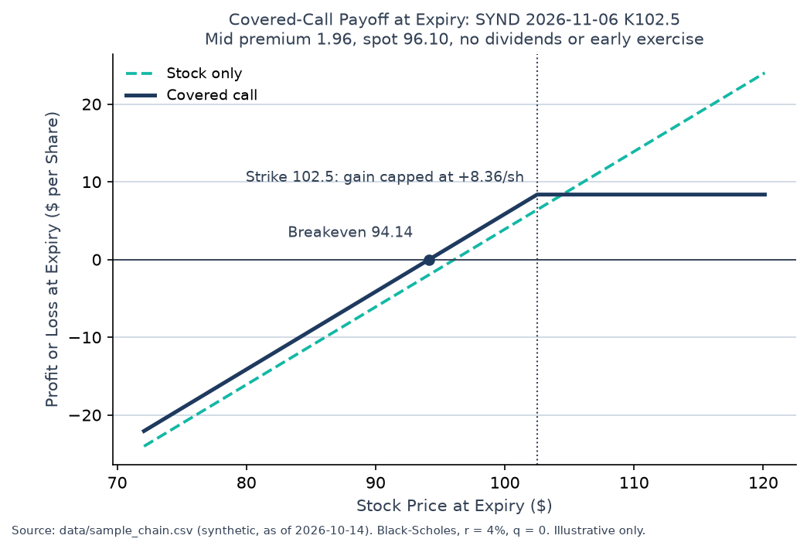
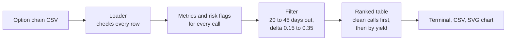
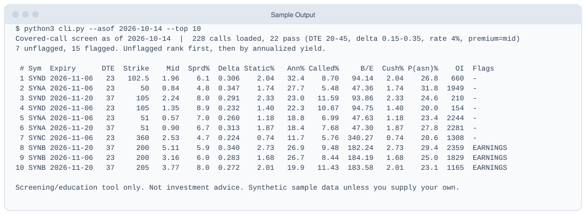
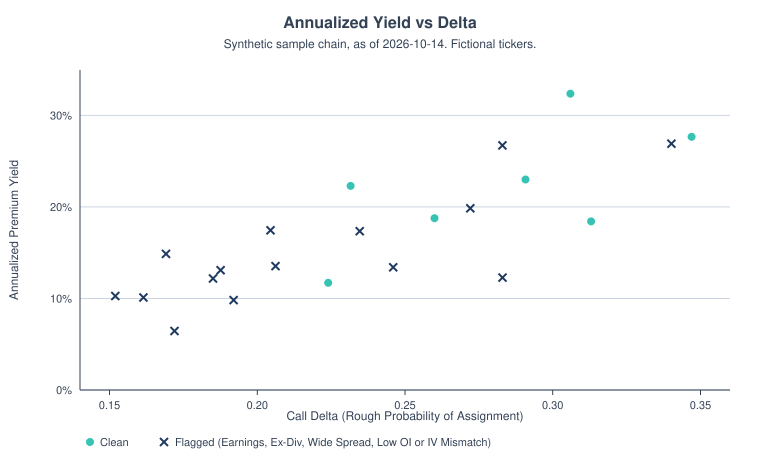
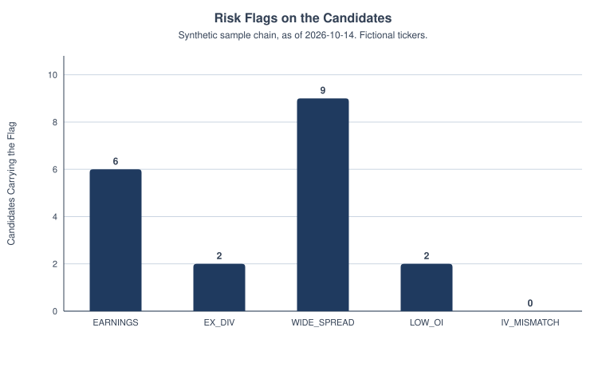
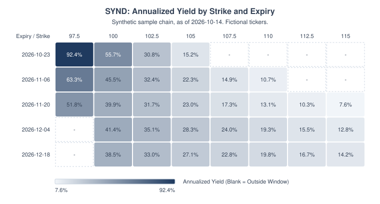
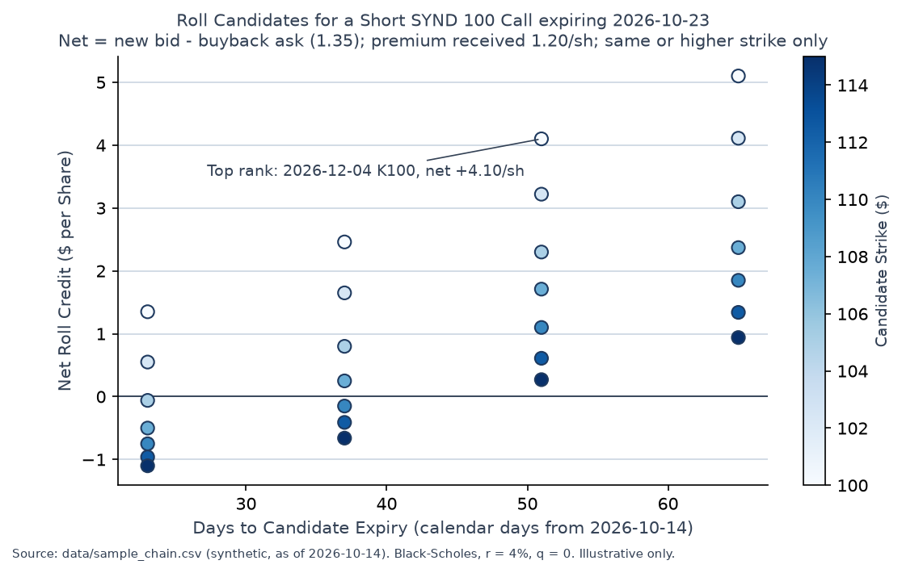
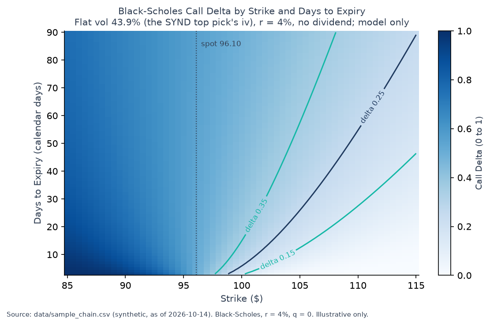

# Covered Call Screener

If you own 100 shares, which call option should you sell against them? This reads an option chain, ranks the candidates, and flags the ones with a catch.

On the sample chain (synthetic, fictional tickers), the top pick pays **2.04% in 23 days, about 32% annualized**, and the shares only get sold if the stock rises more than 6.7%.



## The idea in plain words

A covered call means you own the shares and sell someone the right to buy them from you at a set price (the strike) by a set date (the expiry). You get paid cash up front (the premium). In exchange, you give up any gain above the strike.

- **Breakeven:** the share price minus the premium. Below that, the position loses money at expiry.
- **Called away (assigned):** the stock finishes above the strike and the buyer takes your shares at the strike.
- **Delta:** how much the option's price moves when the stock moves $1. It also works as a rough guide to the chance of being called away. The screener keeps deltas between 0.15 and 0.35 by default.
- **Implied volatility (IV):** how big a move the option's price is betting on. Higher IV means a fatter premium and more risk.

## How it works



The flags are the traps a yield number hides:

| Flag | What it means |
|---|---|
| `EARNINGS` | An earnings report lands before expiry, so the stock can gap. |
| `EX_DIV` | A dividend date falls before expiry, when the buyer may take the shares early to collect it. |
| `WIDE_SPREAD` | The gap between the bid and ask is wide, so the quoted premium is hard to actually get. |
| `LOW_OI` | Few open contracts (open interest), so the option is thinly traded. |
| `IV_MISMATCH` | The quoted price doesn't match what its own implied volatility says it should be. Likely bad data. |

## The result (synthetic chain, fictional tickers)

Selling one SYND 102.50 call, 23 days out, against shares at $96.10:

- Collects $1.96, a **2.04% return in 23 days**, about **32% annualized**.
- Breakeven is **$94.14**. Below that, the position loses money at expiry.
- If called at 102.50, the return is **8.70%**. Above the strike, gains go to the buyer. At $110 the covered call makes +$8.36 a share vs +$13.90 for just holding the stock.
- Black-Scholes delta is 0.31, and the risk-neutral chance of finishing in the money is 27%. That's a pricing number, not a forecast.

Of 228 calls in the file, 22 pass the filters and 7 of those carry no flags. This is the real output:

<picture>
  <source media="(prefers-color-scheme: dark)" srcset="docs/sample-output-dark.svg">
  
</picture>

Yield against delta for the 22 that pass. More yield usually means more chance of losing the shares, and the crosses are the flagged ones:

<picture>
  <source media="(prefers-color-scheme: dark)" srcset="docs/yield_vs_delta-dark.svg">
  
</picture>

Which flags show up most:

<picture>
  <source media="(prefers-color-scheme: dark)" srcset="docs/risk_flags-dark.svg">
  
</picture>

The whole SYND chain at once. Closer strikes and nearer dates pay more per year, and carry more risk of assignment:

<picture>
  <source media="(prefers-color-scheme: dark)" srcset="docs/yield_heatmap-dark.svg">
  
</picture>

## Rolling an open call

Rolling means buying back the call you sold and selling a later one. `cli.py roll` prices each later-dated candidate at the net credit (new bid minus the cost to buy back) and ranks them by credit per extra day, not by the biggest credit.



And how delta changes with strike and time, which is why the screener filters on both:



## Run it

Python 3.9+. No installs needed for the screener.

```bash
python3 cli.py --asof 2026-10-14            # rank the bundled chain
python3 cli.py roll -h                      # check whether to roll an open call
python3 -m unittest discover                # tests
```

`python3 make_svgs.py` redraws the SVG charts on this page with no installs. `python3 figures.py` re-prints the worked example and rebuilds the three PNG charts (needs matplotlib).

## Limits

The chain is synthetic, and the ranking hasn't been backtested against just holding the stock. Next step: real delayed chains and a backtest. This is a screening and learning tool, not investment advice.

## What I fixed along the way

- Implied volatility typed as a percent (44 instead of 0.44) produced nonsense deltas. It's now rejected with a clear message.
- The output once called N(d2) a real-world probability of assignment. It's now labelled as the risk-neutral number it is.

Full concepts, formulas and methods: [docs/reference.md](docs/reference.md).
