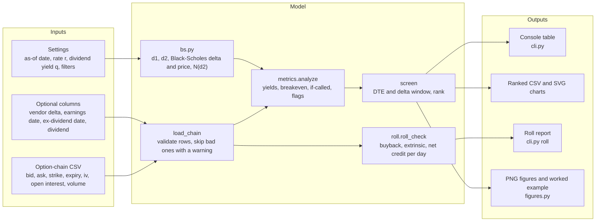
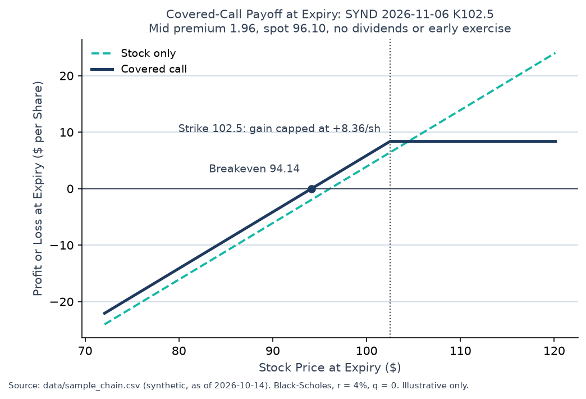
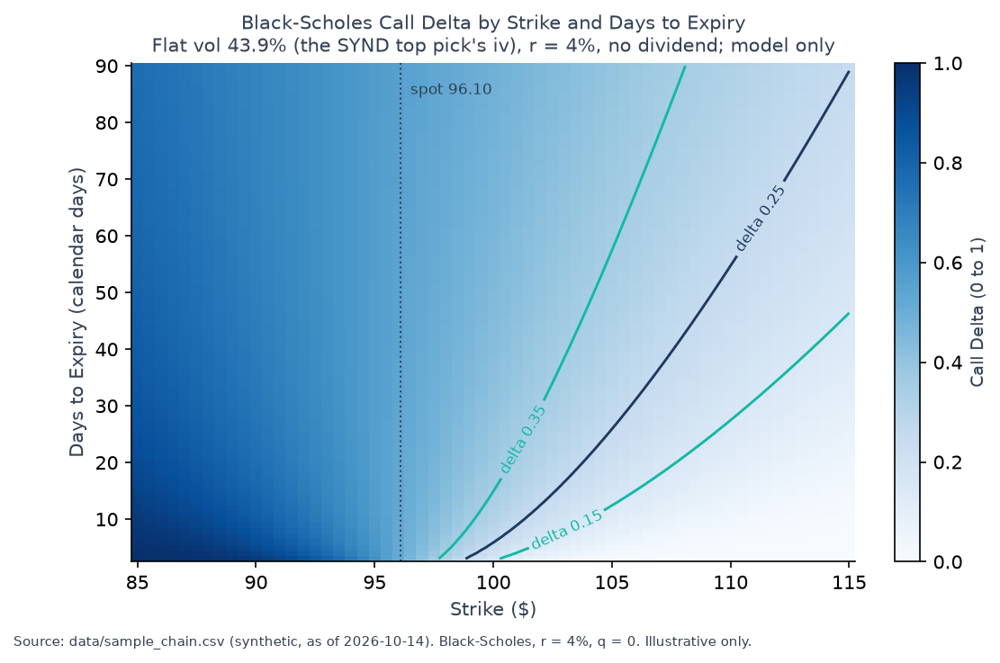
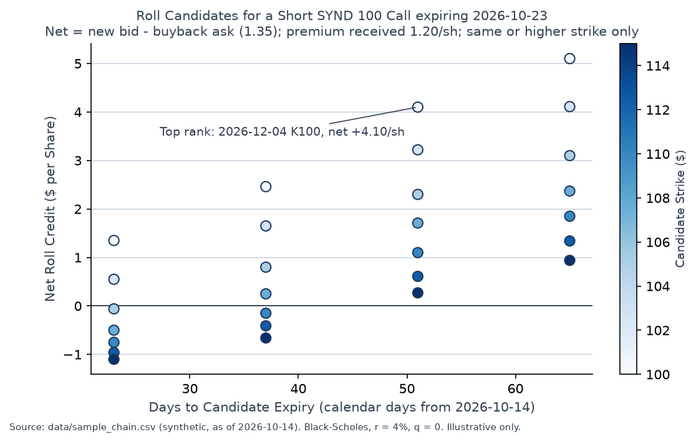

# Covered Call Screener: full reference

The short project overview is in the [README](../README.md). This page keeps the full detail: concepts and formulas, architecture, the worked example, methodology and validation.

> **Synthetic data only.** Every number in this README comes from a bundled chain with fictional tickers (SYNA to SYND) and simulated prices. The results illustrate the mechanics. They are not live market data and not investment advice.

## 1. Executive Summary

Covered-Call Screener is a small Python tool that reads a list of option prices (an option chain) and ranks which call options to sell against shares you already own. For each call it shows how much premium you collect, the price at which you break even, your total return if the shares are sold at the strike, a model-based estimate of the chance the call is exercised, and warning flags for risks such as earnings or an ex-dividend date before expiry. It also includes a read-only roll check for an open position, which estimates the cost and credit of buying back the call and selling a later one. The core uses only the Python standard library, and the pricing formulas are tested against textbook values and hand calculations. The author has a background in mortgage, FP&A and treasury work, and built this as a portfolio project to show options pricing and screening skills.

## 2. Key Concepts

**Covered call.** You own 100 shares and sell one call option, which gives a buyer the right to buy those shares at the **strike price** K by the **expiry** date. You keep the **premium** P whatever happens. If the stock finishes above K, your shares are sold at K and your gain stops there. The payoff per share at expiry, with S0 the price today and S_T the price at expiry, is:

$$\text{Payoff}(S_T) = P + \min(S_T, K) - S_0$$

**Annualized yield.** Yield is the premium as a share of the stock price, scaled to a year. **DTE** (days to expiry) is the number of calendar days left. Annualizing lets you compare a 2-week call with a 2-month call, but it assumes you can repeat the same trade all year, and it is simple interest, not compounded.

$$\text{Annualized yield} = \frac{P}{S_0} \cdot \frac{365}{\text{DTE}}$$

**Breakeven and if-called return.** The **breakeven** is the stock price at which the premium exactly offsets a fall in the stock, so you lose money below it if you hold to expiry. The **if-called return** is your total return if the shares are sold at K, counting the premium and the rise up to the strike. It ignores dividends.

$$\text{Breakeven} = S_0 - P, \qquad \text{If-called return} = \frac{P + K - S_0}{S_0}$$

**Black-Scholes price and delta.** **Black-Scholes** is the standard closed-form formula for a European option (one that can only be exercised at expiry). It takes the spot price S, strike K, time T in years, risk-free rate r, **implied volatility** sigma (the volatility the market price implies), and dividend yield q. **Delta** is how much the call price moves for a $1 move in the stock. It also serves as a rough guide to the chance of finishing in the money, but it is not a forecast.

$$d_1 = \frac{\ln(S/K) + (r - q + \sigma^2/2)\,T}{\sigma\sqrt{T}}, \qquad d_2 = d_1 - \sigma\sqrt{T}$$

$$C = S\,e^{-qT} N(d_1) - K\,e^{-rT} N(d_2), \qquad \Delta = e^{-qT} N(d_1)$$

**Risk-neutral chance of finishing in the money.** $N(d_2)$ is the probability that the call finishes in the money if the stock grows at the risk-free rate. It is a pricing-model quantity and the tool labels it `P(asn)%`, but it is not the real-world probability of assignment. With no dividend yield it sits below delta. With a dividend yield it can sit above delta.

$$P(\text{finish ITM}) \approx N(d_2)$$

**Early assignment and ex-dividend dates.** A US stock option is American, so the buyer can exercise before expiry. The usual reason is to capture a dividend just before the **ex-dividend date**, the cutoff for owning the stock to receive the next payment. A short call whose remaining time value (extrinsic value) is small compared with the dividend is at risk. The tool flags this with a rule of thumb, not a price.

$$\text{Extrinsic} = \text{Premium} - \max(S - K, 0), \qquad \text{Risk flag if Extrinsic} < \text{Dividend (rule of thumb)}$$

**Implied volatility check.** **Implied volatility** (IV) is the volatility that makes the model price equal the market **mid** (the midpoint of bid and ask). The tool recomputes the Black-Scholes price at each row's own IV and compares it with the mid. Because the IV comes from the same quote, this check mainly catches stale or inconsistent rows, not mispriced options.

$$\text{Model gap} = \text{mid} - C(\sigma_{\text{row}})$$

**Rolling.** To **roll** an open short call, you buy it back (at the **ask**, the higher price) and sell a later-expiry call (at the **bid**, the lower price). The **net roll credit** is the new bid minus the buyback ask, a conservative fill. The if-called return after the roll adds that credit to the premium you already received.

$$\text{Net roll credit} = \text{Bid}_{\text{new}} - \text{Ask}_{\text{buyback}}, \qquad R_{\text{if-called}} = \frac{P + \text{Net roll credit} + K_{\text{new}} - S}{S}$$

## 3. Architecture



The loader rejects bad input (nan, percent-style IV such as 32 instead of 0.32, delta outside 0 to 1) and reports it, so nothing is silently rescaled. The screen then computes each call's numbers, filters by days to expiry and delta, and ranks unflagged calls first. The roll check reads the same chain for a single open position.

## 4. Worked Example (Illustrative, Synthetic Data)

Contract: sell 1 SYND call, expiry 2026-11-06, strike 102.50, against 100 shares. Spot is 96.10, the bid is 1.90 and the ask is 2.02, the chain's implied vol is 43.89%, the risk-free rate is 4%, and there is no dividend. Today is 2026-10-14. The figures below come from `python3 figures.py`, which computes them from the bundled sample chain.

| Step | Calculation | Result |
|---|---|---|
| 1. Days to expiry | 2026-11-06 minus 2026-10-14 | 23 days (T = 0.0630 years) |
| 2. Mid premium | (1.90 + 2.02) / 2 | 1.96 |
| 3. Spread | (2.02 - 1.90) / 1.96 | 6.1% of mid |
| 4. Static return | 1.96 / 96.10 | 2.04% |
| 5. Annualized yield | 2.04% x 365 / 23 | 32.4% |
| 6. If-called return | (1.96 + 102.50 - 96.10) / 96.10 | 8.70% |
| 7. Breakeven | 96.10 - 1.96 | 94.14 |
| 8. d1, d2 | Black-Scholes with the chain's IV | -0.5072, -0.6174 |
| 9. Delta | N(d1) | 0.306 (model; no vendor delta in this file) |
| 10. Chance of finishing in the money | N(d2) | 26.8% (risk-neutral, not a forecast) |
| 11. Model gap | mid 1.96 vs model 1.9560 | +0.0040 (data check, passes) |

The same row from the screener (`python3 cli.py --asof 2026-10-14 --top 1`):

```
 # Sym  Expiry      DTE  Strike    Mid  Sprd%  Delta Static%   Ann% Called%     B/E  Cush% P(asn)%    OI  Flags
 1 SYND 2026-11-06   23   102.5   1.96    6.1  0.306    2.04   32.4    8.70   94.14   2.04    26.8   660  -
```

If the stock finishes at 110, the covered call returns +8.36 per share (capped at the strike), while holding the stock alone returns +13.90. If you could only fill at the bid (1.90), the annualized yield falls to 31.4%.

**Interpretation:** Selling this call would collect 2.04% in 23 days, about 32% a year, and the position stays profitable down to 94.14, but gains above 102.50 go to the buyer.

## 5. Visuals

All three figures are written by `figures.py` to `docs/figures/`. Each uses the bundled synthetic chain, and each carries a source note on the image.



*Figure 1. Payoff at expiry per share, covered call (navy) against stock only (teal dashed), for the worked example. Below 94.14 the position loses money; above 102.50 the gain stops growing. Assumes mid premium, no dividends and no early exercise.*



*Figure 2. Model call delta by strike and days to expiry, with the spot price marked. Contour lines show the 0.15 to 0.35 delta band the screener filters on. Uses one flat vol of 43.9% for the whole surface, so it shows the model's shape, not a volatility smile.*



*Figure 3. Roll candidates for a short SYND 100 call expiring 2026-10-23 (premium received 1.20 per share, buyback ask 1.35). Each point is one later-expiry call with a strike of at least 100, plotted at its net credit (new bid minus buyback ask). The top rank is the best credit per extra day of duration, not the biggest credit, so it is 2026-12-04 at +4.10 per share. Research estimate, not advice.*

## 6. Methodology and Assumptions

**Inputs.** The chain CSV must have `underlying, spot, expiry, strike, bid, ask, iv, open_interest, volume`. Optional columns are `delta, ex_dividend_date, earnings_date, dividend`. Dates are ISO (`YYYY-MM-DD`), IV is a decimal (0.32 = 32%), and lines starting with `#` are comments. The loader skips bad rows with a warning. The tool makes no network calls.

**Simplifications, stated plainly:**

- **European exercise.** Black-Scholes assumes the option can only be exercised at expiry. US single-stock options are American, so the buyer can exercise early, and the price of that right is not in the model. Early exercise is flagged (`EARLY_ASSIGN`), not priced.
- **Constant volatility per row.** Each call uses its own `iv` from the file, with no smile fitting and no volatility-surface checks.
- **Fixed risk-free rate.** The default is 4% (`--rate`). The synthetic sample was generated at 4.25%, a difference the 10% model-gap tolerance absorbs.
- **Dividends.** The model uses a continuous dividend yield q (default 0, `--div-yield`). Cash dividends are not in the price, the if-called return or the yield; they only appear in the early-assignment and roll signals.
- **Premium.** The default is the mid price, which is optimistic on a wide market. `--basis bid` gives the conservative view.
- **Yield.** Annualized yield is simple (not compounded) and assumes the trade can be repeated at the same yield. It ignores commissions, taxes, assignment costs and dividends.
- **Calendar days.** DTE counts calendar days over a 365-day year, with no business-day or holiday calendar.
- **Delta and N(d2) are proxies.** Both come from a lognormal model with constant volatility. Neither is a real-world probability of assignment or a forecast.
- **Flags.** `EARNINGS` fires from the as-of date through expiry, inclusive, because a report on the as-of date may come after the close. `EX_DIV` fires when the ex-dividend date falls after the as-of date and on or before expiry. `EARLY_ASSIGN` is a rule of thumb (extrinsic value below the dividend), not the textbook early-exercise test. `WIDE_SPREAD` and `LOW_OI` use thresholds you can set. `LOW_VOLUME` and `THIN_PREMIUM` are off by default.
- **Model gap.** If `iv` is the implied vol of that same quote, the gap is near zero by construction. The check catches inconsistent rows, not mispricing, and the README makes no claim that an option is cheap or rich.
- **Roll check.** It is read-only. It uses the ask to buy back and the bid to sell, ignores commissions and taxes, and marks any candidate with a missing quote as UNKNOWN instead of guessing.

Open issues on the model (the EARLY_ASSIGN test, the tautological IV check, American pricing and dividends in the if-called return) are tracked in the repo's GitHub issues. None of them is fixed silently. The code is MIT licensed (see `LICENSE`).

## 7. Validation

- **Textbook values.** The Black-Scholes price and delta are checked against standard examples: S = K = 100, T = 1, r = 5%, sigma = 20% gives a call price of 10.4506 and delta of 0.6368. Hull's example (S = 42, K = 40, r = 10%, sigma = 20%, T = 0.5) gives 4.76. Reference: John C. Hull, *Options, Futures, and Other Derivatives* (the Black-Scholes-Merton chapters).
- **Dividend case by hand.** With q = 3%, S = K = 100, T = 1, r = 5%, sigma = 20%, the delta is e^-0.03 x N(0.2) = 0.562140 and the price is 8.6525. Both are calculated by hand in the tests and match the code.
- **Payoff and breakeven.** The payoff formula is checked at the strike (flat above it, at the maximum gain) and the curve crosses zero at the breakeven.
- **Roll arithmetic.** Buyback, extrinsic value, net credit and the if-called return after a roll are checked against hand-computed values for a small fixture.
- **Boundary dates.** Earnings and ex-dividend windows are tested on the as-of day, the expiry day and the day after expiry.
- **Worked example.** `figures.py` prints every step of the worked example, and the test suite asserts the key values (mid, DTE, breakeven, if-called return, delta, N(d2)) that the table above quotes.
- **Run the tests:**

```bash
python3 -m unittest discover -v
```

The matplotlib figure test runs only when matplotlib is installed (see Quick Start). The suite runs on Python 3.9 and later.

## 8. Quick Start

Requires Python 3.9 or later. The screener itself has no dependencies. The figures need matplotlib.

```bash
python3 -m venv .venv && source .venv/bin/activate   # one-time setup
pip install -r requirements-extra.txt                # matplotlib, for the figures only
```

Then run this one command. It prints the worked example step by step and regenerates the three figures in `docs/figures/`:

```bash
python3 figures.py
```

For the screener itself, run `python3 cli.py --asof 2026-10-14` on the bundled chain, or `python3 cli.py -h` for every option.
